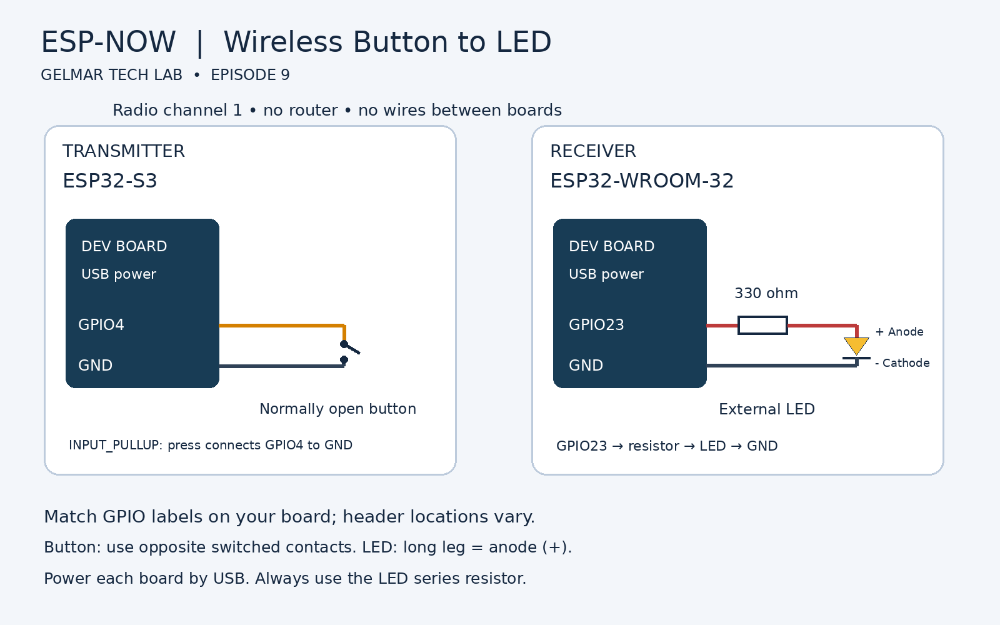

# ESP32 ESP-NOW: Wireless Button to LED
Gelmar Tech Lab | ESP32 Master Course, Episode 9  
Build. Code. Innovate.

Press the transmitter button to turn on the receiver LED. Release to turn it off.
No router or internet is required. This is a new matched pair of sketches; upload BOTH.

## Components and wiring
- ESP32-S3 development board (transmitter)
- ESP32-WROOM-32 development board (receiver)
- Normally open momentary push button
- LED and 330 ohm series resistor
- USB cables and jumper wires

| Board | Connection |
|---|---|
| ESP32-S3 | GPIO4 to one button contact; opposite switched contact to GND |
| ESP32-WROOM-32 | GPIO23 to 330 ohm resistor to LED anode (+, long leg) |
| ESP32-WROOM-32 | LED cathode (-, short leg / flat edge) to GND |

The drawing shows electrical connections, not physical header positions. Follow GPIO labels on your own board. For a four-leg tactile switch, use contacts that are open when released and connected when pressed; two legs on the same side are commonly already connected. No external button pull-up is needed. Power each development board by USB. No wire or shared ground is required between the two boards. Do not connect an LED without its series resistor or apply 5 V to GPIO pins.

## Upload and run
1. Install **esp32 by Espressif Systems** in Arduino IDE Boards Manager. Code targets Arduino-ESP32 3.x, with a 2.x receive-callback compatibility branch. No extra ESP-NOW library is needed.
2. Open `Receiver/Receiver.ino`. Choose **ESP32 Dev Module**, select its port, and upload to the ESP32-WROOM-32 board.
3. Open Serial Monitor at **115200 baud**, press Reset, and copy the receiver's **Station MAC**.
4. Open `Transmitter/Transmitter.ino`. Replace the six zero bytes in `RECEIVER_MAC` with that MAC. Example only: `AA:BB:CC:DD:EE:FF` becomes `{0xAA, 0xBB, 0xCC, 0xDD, 0xEE, 0xFF}`. Do not use this example as your address.
5. Choose **ESP32S3 Dev Module**, select the transmitter port, and upload. For native USB serial on S3, enable **USB CDC On Boot** if your board requires it.
6. Power both boards. Press the button: LED ON. Release: LED OFF.

Keep each `.ino` inside the matching folder. `MAC_Reader` is optional; re-upload the receiver afterward if you use it on that board.

## Behavior and troubleshooting
Both boards use radio channel 1 and Wi-Fi station mode; neither connects to a router. The button is debounced for 30 ms. Its state is repeated every 200 ms. The receiver turns the LED off after 1.5 seconds without valid data. Packets are unencrypted; this is a learning demo, not a secure control system. The receiver accepts any valid one-byte state on this channel; sender filtering is not included.

If the LED does not respond, check the receiver station MAC, LED polarity, GPIO labels, USB power and selected boards. A transmitter `queue: OK` message only means the send request was accepted; it does not confirm delivery. Turn the transmitter off while holding the button to check that the receiver times out.

## Official references
- [Espressif Arduino ESP-NOW documentation](https://docs.espressif.com/projects/arduino-esp32/en/latest/api/espnow.html)
- [Espressif ESP-NOW protocol and API](https://docs.espressif.com/projects/esp-idf/en/stable/esp32/api-reference/network/esp_now.html)
- [Arduino-ESP32 installation](https://docs.espressif.com/projects/arduino-esp32/en/latest/installing.html)
- [Gelmar Tech Lab YouTube](https://www.youtube.com/@gelmartechlab)

## Validation
Prepared by source review against Espressif documentation. Not compiled or tested on physical boards in this environment. Verify the complete pair on your hardware before publishing as tested code.
